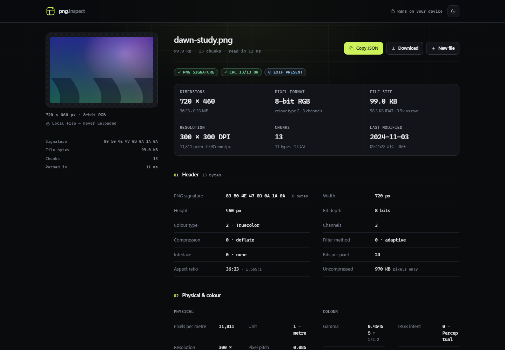

# png.inspect

**A free web page that shows you what is inside a PNG file — without uploading it anywhere.**

Drop a PNG onto the page and read its dimensions, resolution, colours, text notes, camera data and every internal block of the file. Everything happens in your browser. No account, no install, no server.

[**Open the live demo →**](https://ahm-ge18.github.io/png-metadata-viewer/)



---

## What is this, in plain words?

A PNG image is more than pixels. The file is a stack of labelled blocks called **chunks**, and many of them contain information *about* the image: how big it is, how dense its pixels are, what colours it uses, when it was last saved, which camera or app made it, and any text the author attached.

`png.inspect` opens that stack and shows it in a readable way. It reads the file's bytes — it does not decode or re-save the picture — so it works even on files that are damaged or that a normal image viewer refuses to open.

---

## Try it in 30 seconds

1. Open the [live demo](https://ahm-ge18.github.io/png-metadata-viewer/).
2. Drag a `.png` file onto the big dashed box. (You can also click the box to browse, or press `Ctrl+V` / `⌘V` to paste a copied image.)
3. Scroll down. The page fills with the file's metadata.
4. Press **Copy JSON** if you want the whole result as text you can paste into a bug report, a spreadsheet or a catalogue.

That's it. There is no sign-up and nothing to install.

> **Heads-up:** this tool only reads PNG files. A JPG, WebP, GIF or PDF is politely refused. It never changes or deletes your original file.

---

## What the page shows you

| Section | What you learn |
| --- | --- |
| **Summary cards** | Dimensions, file size, pixel format, DPI, number of chunks, last-saved time |
| **Header** | The PNG signature, width, height, bit depth, colour type, compression, filtering, interlacing |
| **Physical & colour** | Pixels per metre, DPI, pixel pitch, gamma, sRGB intent, white point, ICC profile, palette swatches |
| **Text entries** | Every `tEXt`, `zTXt` and `iTXt` note — author, software, comments, titles — including compressed and non-English ones |
| **EXIF** | Camera make/model, lens, exposure, ISO, software and dates, when an `eXIf` block is present |
| **Chunk map** | Every block in the file, its size, whether its checksum is valid, and a hex preview |
| **JSON** | The entire result, ready to copy or download |

It also warns you about problems instead of hiding them: a bad checksum, a missing end marker, a truncated block, or bytes left over after the image.

---

## Why would I need this?

- **Check a screenshot or asset before publishing** — is it really 2× retina, or did an export tool quietly save it at 72 DPI?
- **Find out where an image came from** — the `Software` text entry often names the editor, and EXIF may name the camera.
- **Debug a broken PNG** — see which chunk has a bad CRC or whether the file simply stops halfway.
- **Strip or inspect privacy-sensitive notes** — some editors store author names, comments or timestamps in text chunks.
- **Learn the PNG format** — the chunk map is a hands-on tour of how the file is built.

---

## Privacy

- Your file is **never uploaded**. All parsing happens in the page's own memory.
- There are **no analytics, no tracking and no third-party fonts or scripts**.
- Once the page has loaded, it works offline. You can turn off Wi-Fi and keep inspecting files.
- The only thing saved is your light/dark theme choice, in your browser's `localStorage`. Closing the tab clears the loaded file.
- The original file is **read-only** from the tool's point of view. Nothing is rewritten.

---

## PNG in 60 seconds (small glossary)

You do not need to know any of this to use the tool, but it makes the results easier to read.

| Term | Meaning |
| --- | --- |
| **Chunk** | One labelled block inside a PNG. Each has a 4-letter type, a length, its data, and a CRC checksum. |
| **IHDR** | The first chunk: width, height, bit depth, colour type, compression, filter and interlace method. |
| **IDAT** | The compressed pixel data. Large images have several of these. |
| **IEND** | The final "end of image" chunk. If it is missing, the file was probably cut off. |
| **CRC** | A checksum stored with each chunk. If it does not match the data, the chunk is corrupt. |
| **tEXt / zTXt / iTXt** | Three ways to store text. `zTXt` is compressed, `iTXt` supports Unicode (accents, emoji, non-Latin scripts) and language tags. |
| **pHYs** | Physical pixel size in pixels per metre. The tool converts it to DPI (dots per inch). |
| **gAMA / sRGB / iCCP** | Colour information: gamma, a standard colour space, or an embedded ICC profile. |
| **tIME** | The last time the file was modified, in UTC. |
| **eXIf** | Optional EXIF metadata (camera, lens, exposure). PNG has no native EXIF; it lives in this chunk. |
| **APNG** | Animated PNG. The tool detects it through `acTL`, `fcTL` and `fdAT` chunks. |

---

## Run it on your own computer

You do **not** need Node.js, npm or a build step to use the app.

### Option A — just open the file (easiest)

1. Download or clone this repository.
2. Double-click `index.html`.

It works straight from your disk in Chrome, Edge, Firefox and Safari. Some browsers limit a few features on `file://` pages (usually the clipboard); if **Copy JSON** does nothing, use **Download** instead, or use Option B.

### Option B — use a tiny local server

If you have Python installed:

```bash
cd png-metadata-viewer
python -m http.server 8000
```

Then open <http://localhost:8000>.

Or, if you have Node.js 18 or newer:

```bash
npm start
```

This uses `npx serve` and prints a local address for you.

### Downloading the project without Git

On the GitHub page, click the green **Code** button → **Download ZIP**, then unzip it. No Git knowledge required.

---

## Using the tool, step by step

1. **Load a PNG.** Drag it anywhere on the page, click the drop box, or paste with `Ctrl+V` / `⌘V`.
2. **Check the preview.** The left rail shows the image plus its signature, byte count, chunk count and how long parsing took.
3. **Read the summary cards** for the numbers most people want: size, pixel format, DPI and modification time.
4. **Open a section** by scrolling. The **Header** section is the technical core; **Physical & colour** explains how the image should be displayed.
5. **Inspect text entries.** Each keyword (such as `Software` or `Author`) is shown with its full value and a copy button.
6. **Open the chunk map** and click any row to see its parsed fields, flags, offset, CRC values and the first bytes in hex.
7. **Filter the chunk list** with the search box — try `text`, `IDAT` or `pHYs`.
8. **Export.** **Copy JSON** puts the entire result on your clipboard; **Download** saves a `.metadata.json` file next to your image.
9. **Start over.** Click **New file** (or press `Esc`) to clear everything and load another image.

The moon/sun button in the top-right switches between dark and light themes.

---

## Project files

You only need three things to run the app: `index.html`, `styles.css`, and the two files in `js/`.

```
index.html              the page: header, drop zone, result layout
styles.css              colours, typography and responsive layout
js/png.js               the PNG parser (chunks, CRC-32, text, EXIF, APNG)
js/app.js               rendering, interactions, JSON export
test/parser.test.mjs    automated parser tests with in-memory PNG fixtures
docs/screenshot.png     the image at the top of this README
package.json            test/start shortcuts (no runtime dependencies)
```

There are **no libraries** and no build tools. The code is plain HTML, CSS and JavaScript.

---

## Run the tests

The tests build PNG files in memory and check that the parser reads them correctly. This needs Node.js 18+.

```bash
npm test
```

or directly:

```bash
node test/parser.test.mjs
```

They cover plain text, compressed text, international text, EXIF, indexed palettes, APNG detection, bad checksums and truncated files.

---

## Deploy your own copy to GitHub Pages

GitHub Pages hosts static sites for free. This project is already a static site, so deployment is just "put the files in a repository and switch Pages on".

1. **Create a new repository** on <https://github.com/new>. A public repository is fine (Pages is free for public repos). Do not add a README if you plan to push this project — you already have one.

2. **Push these files** from your computer. Replace `YOUR-USERNAME` and `YOUR-REPO`:

   ```bash
   cd png-metadata-viewer
   git init
   git add .
   git commit -m "Initial commit"
   git branch -M main
   git remote add origin https://github.com/YOUR-USERNAME/YOUR-REPO.git
   git push -u origin main
   ```

   If you are not comfortable with Git, use the GitHub website instead: open the empty repository → **Add file** → **Upload files** → drag in everything from this folder → **Commit changes**.

3. **Turn on Pages.** In the repository, open **Settings** → **Pages** (left sidebar). Under **Build and deployment**:
   - **Source:** Deploy from a branch
   - **Branch:** `main`
   - **Folder:** `/ (root)`
   - Click **Save**.

4. **Wait a minute or two**, then reload the Pages settings. GitHub shows the address, usually:

   ```
   https://YOUR-USERNAME.github.io/YOUR-REPO/
   ```

   Every future push to `main` updates the site automatically.

That's the same setup this live demo uses: <https://ahm-ge18.github.io/png-metadata-viewer/>.

---

## Troubleshooting

**"That file is a JPEG / WebP / GIF…"**
The tool reads PNG chunks only. Open the image in an editor and export it as PNG if you need its metadata.

**Nothing happens when I drop a file.**
Make sure JavaScript is enabled, and try a current version of Chrome, Edge, Firefox or Safari. Files over 100 MB are refused on purpose.

**A compressed text entry shows a warning.**
Compressed `zTXt`, `iTXt` and `iCCP` blocks need the browser's built-in `DecompressionStream`. Update your browser — every current major browser has it. All other chunks still work.

**The preview is blank, but the metadata appears.**
The header is readable but the pixel data is incomplete or corrupt. That is exactly the kind of problem the chunk map helps you find.

**Copy JSON does nothing.**
Some browsers block clipboard access on `file://` pages. Use **Download** instead, or serve the folder over `http://localhost` (see above).

**The DPI looks odd (for example 72.009).**
PNG stores pixels *per metre*, not per inch. The tool converts the value, so 2835 px/m becomes 72.009 DPI. That is normal and correct.

**Can I inspect several files at once?**
One at a time. Load the next one with **New file** or by dropping it on the page.

---

## Limits

- PNG only, one file at a time, up to 100 MB.
- EXIF parsing covers the common tags (camera, lens, exposure, dates, software). Unusual or maker-specific tags may not be shown, but they remain in the raw `eXIf` chunk.
- The tool reads metadata; it does not edit, strip or re-save it.

---

## Licence

MIT — use it, modify it, publish your own version.
